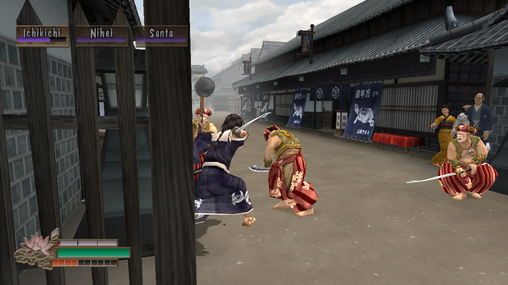
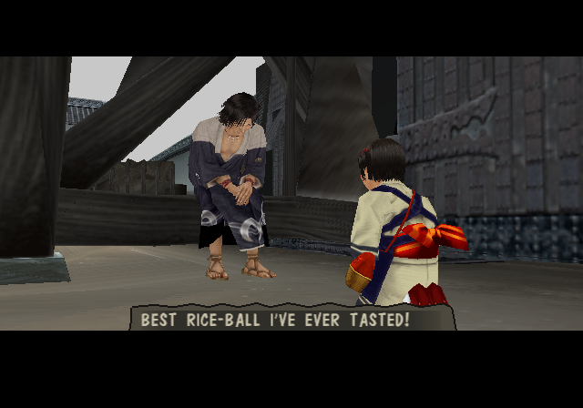
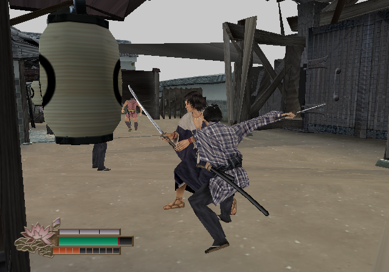
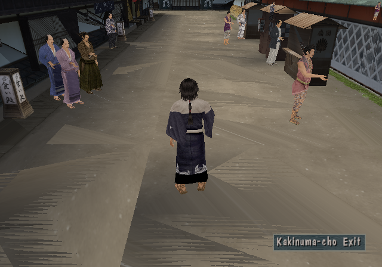
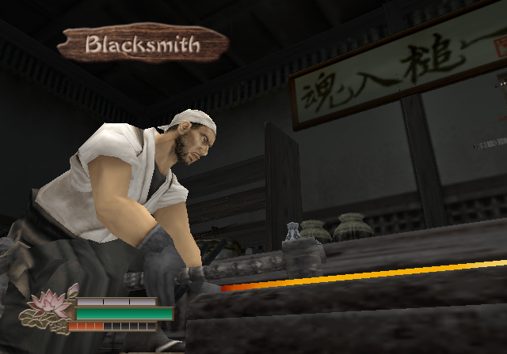
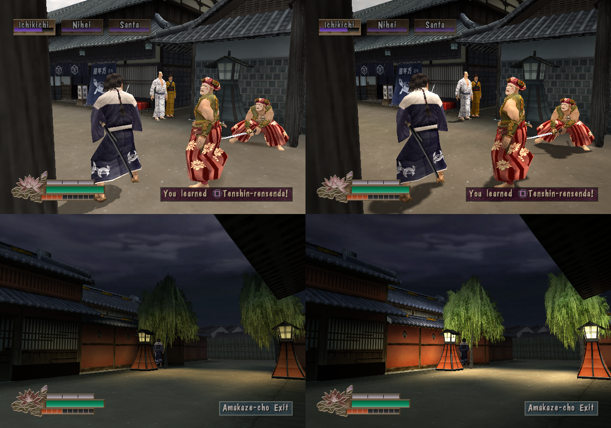
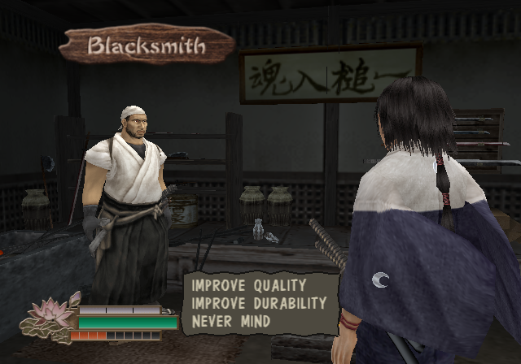

<div align="center">

# 侍道2 — Way of the Samurai 2, native

**The 2004 PS2 cult classic, decompiled and running as a real Linux and Windows program.**
**No emulator. No interpreter. Widescreen, any resolution, any frame rate.**



</div>

---

Ten days in Amahara. A hungry ronin, a mute girl, a rice ball, three thugs — and
then every choice is yours. *Way of the Samurai 2* never left the PlayStation 2.

This project takes the game's MIPS machine code apart function by function,
rewrites it as C++, and runs it natively: the game's own logic, its own data,
its own scripts — on your CPU, through OpenGL and SDL2.

**You can play it from the title screen to the staff roll.**

## What runs

| | |
|---|---|
|  |  |
| **The whole story** — all 102 story and shop scripts run on a reimplementation of the game's scripting VM, through to the endings. | **Sword fighting** — combos, guards, parries, the fight AI, experience and learned techniques, swords that wear down and break. |
|  |  |
| **A living town** — ten areas, day and night, people going about their business on the game's own task scripts. | **Everything around it** — shops, the inn, the blacksmith, your home, the sword safe, items, accessories, saving and loading. |

Also in: the opening and ending movies, voiced dialogue with lip movement and
facial expressions, music and sound effects, the sky, water, fog, shadows,
blood, sparks and blade trails, and controller support.

## Mods, built in

A mod loader ships with four mods switched on:

- **Widescreen** — the 3D view opens out to the sides. 16:9, 21:9, whatever shape your window is.
- **Resolution** — draw at 1080p, 4K, or as many lines as your window has, instead of the PS2's 448.
- **FPS unlock** — 60, 120, 144 pictures a second. The game still thinks at 30; everything in between is interpolated.
- **Modern lighting** — real sun shadows from every character and object, ambient occlusion, lanterns that light the street at night, bloom and a colour grade.



Each is a folder with an `.ini` you can edit. Writing your own takes one header:
replace any game file by dropping it in a folder, or load code that reads and
writes the game's memory every frame. The guide is [`mods/README.md`](mods/README.md).
**HD texture packs made for PCSX2 work as they are:** put the pack's `.dds` files in a
mod's `textures/` folder.

**A level editor is built in too:** press F2 in the world to move, add and
remove objects, paint where one can walk, and save the result as a mod.

<div align="center">



</div>

## Play it

**You need your own copy of the game** — the NTSC-U disc, `SLUS-208.93`. Nothing
from the disc is in this repository.

**Prebuilt:** download the Linux or Windows package from
[Releases](https://github.com/acklavidian/decomp_wots2/releases), unpack it, and
start `wots2` / `wots2.exe`. The first time it asks for your disc image. Each
package has a README.txt.

**From source (Linux):**

```bash
# 1. Dependencies (Debian / Ubuntu / Pop!_OS)
sudo apt install build-essential cmake ninja-build libsdl2-dev libgl-dev libarchive-dev ffmpeg

# 2. Build
cmake -B build -G Ninja && ninja -C build

# 3. Go — hand it your disc image the first time
./build/wots2 "Way of the Samurai 2.iso"
```

The launcher unpacks the game's files once (into `extracted/`, about 1.5 GB) and
starts the game; after that plain `./build/wots2` is enough. It takes an `.iso`,
or a `.zip` / `.7z` / `.rar` / `.tar.*` holding the image or the files
themselves. Start it without an argument and it asks for the file in a window.

`ffmpeg` is only needed for the movies. F11 toggles fullscreen. Saves go in
`wots2_card/`.

### Controls

| | Controller | Keyboard |
|---|---|---|
| Run / walk | Left stick or d-pad | Arrows / T G F H |
| Sprint (sword away) | Press L3 while running (off when you let go of the stick) | C |
| Jump, confirm | Cross (bottom) | Z |
| Talk | Circle (right) | X |
| Attack, pick up | Square (left) | A |
| Attack, cancel | Triangle (top) | S |
| Draw / sheathe | L1 | Q |
| Guard (+ Square: kick) | R1 | W |
| Camera | Right stick (R3: back behind) | J L / I K (V: back behind) |
| Pause menu | Start | Enter |

## How it works

```
 SLUS_208.93 (MIPS R5900)                    this repository
┌─────────────────────────┐      ┌──────────────────────────────────────┐
│ game + engine code      │ ───▶ │ src/game, src/engine   decompiled C++ │
│ data, vtables, tables   │ ───▶ │ loaded at its real PS2 addresses      │
│ GS · SPU2 · pad · disc  │ ───▶ │ src/hal   OpenGL · SDL2 audio · input │
└─────────────────────────┘      └──────────────────────────────────────┘
```

- **Pure decompilation.** Each function is read out of Ghidra and the
  disassembly and rewritten by hand. There is no MIPS interpreter anywhere.
- **Guest memory.** The game's data is mapped at the addresses it had on the
  PS2, so decompiled code and original data tables agree without translation.
  Calls through vtables go through a registry of address → native function.
- **Hardware boundary.** The Graphics Synthesizer becomes an OpenGL renderer
  that records each frame as a draw list — which is what lets the same frame
  be replayed wider, sharper, and in between.

About 1,900 of the binary's ~4,600 functions are decompiled. Much of the rest
is the script compiler, Sony's libraries and debug screens the game never
shows.

## Honest status

It plays start to finish, and automated runs take whole games through to an
ending without a crash. It is not finished:

- Map and model **drawing and lighting are native approximations**, not the
  original's VU1 code. It looks right; it is not bit-exact.
- It has **not been compared side by side with the original** on real hardware
  or PCSX2 for timing, sound and feel.
- **Windows** builds have been tested under Wine, not yet on a real Windows
  machine. macOS is not done yet.

Found something that looks or plays wrong? That's the most useful thing you can
report.

## Poking around

```bash
tools/ghidra_decomp.sh 0x1C3AC0        # Ghidra pseudocode for a function
tools/volume.py list                   # what's in VOLUME.DAT
tools/sx.py src CTX/Opening            # read an event script
tools/task.py dump shop.bin            # read an NPC's task script
WOTS2_MODEL_VIEW=shujinko_01 ./build/wots2 extracted    # model viewer
WOTS2_MAP_VIEW=numata        ./build/wots2 extracted    # fly through a map
```

## Legal

This repository contains none of the game's binaries, assets or disc contents. It is
an independent, non-commercial preservation and research project, not
affiliated with or endorsed by Acquire, Spike or Capcom. *Way of the Samurai*
is a trademark of its owners. You must own the game to use this.
